<p align="center">
  
</p>

<h1 align="center">DataDazzle</h1>

<p align="center"><b>Design your tables. Own your data.</b></p>

<p align="center">
  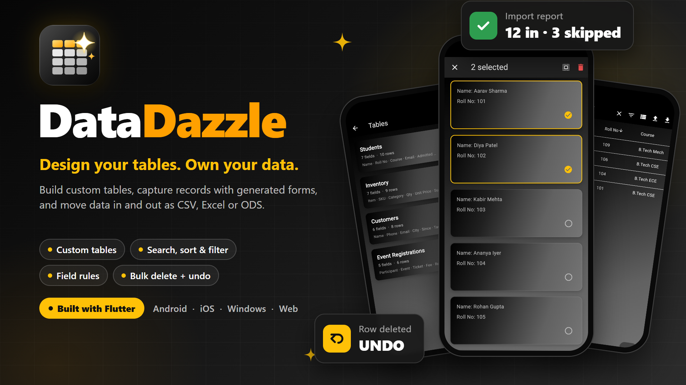
</p>

DataDazzle is a Flutter app for building your own data tables and moving data in and out of them. Define a table and its fields, add rows through generated forms, then search, sort, filter, import and export. Everything is stored locally in SQLite, with no account needed.

## Features

- **Custom tables**: create tables with your own fields, then edit, reorder or remove them.
- **Generated forms**: add and edit rows through forms built from the table definition, with list fields and grouped subfields.
- **Two views**: a spreadsheet-style table and a card view. Both are responsive across phone, tablet and desktop widths.
- **Search, sort and filter**: search every field at once, tap a column header to sort (numbers sort numerically, empty values last), and filter by any field. Filters and search combine.
- **Field rules**: mark a field *required* or *unique*, give it a *default value*, a *min / max* (value for integers, length for text) and a *regex pattern*. The entry form and the importer enforce the same rules.
- **Bulk actions and undo**: long-press to multi-select, select all, delete in bulk, and undo any delete from the snackbar (rows return with their original order).
- **Import**: CSV, XLSX and ODS. Columns are matched by header name (not position), every row is validated, and you get a report such as "12 imported, 3 skipped" listing each skipped row and why.
- **Export**: CSV and XLSX.
- **Local storage**: an on-device SQLite database with a versioned migration hook for future schema changes.

### Field rules

| Rule | Applies to | Enforced on |
| --- | --- | --- |
| Required | every field type, including lists and files | form, import |
| Unique (case-insensitive) | single-value text, integer, email | form, import (also against existing rows) |
| Default value | single-value text, integer, email | new rows, import of empty cells, rows that existed before the field was added |
| Min / max | integer value, text length | form, import |
| Pattern (regex, full match) | text, email | form, import |

## Screenshots

Thumbnails link to the full-size images in [`docs/screenshots`](docs/screenshots).

<table>
  <tr>
    <td align="center"><a href="docs/screenshots/mobile-home.png">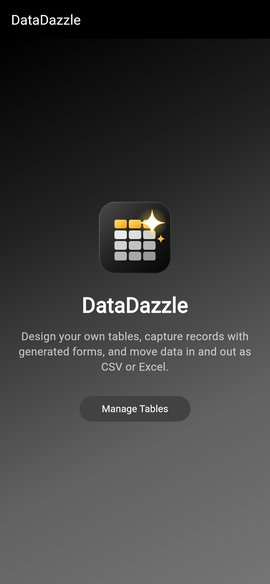</a><br><sub>Home</sub></td>
    <td align="center"><a href="docs/screenshots/mobile-tables.png">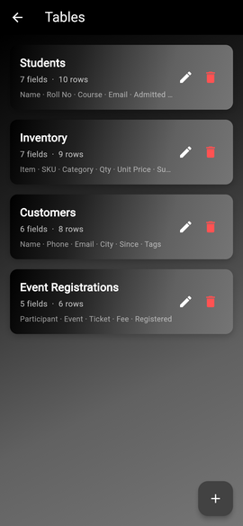</a><br><sub>Tables</sub></td>
    <td align="center"><a href="docs/screenshots/mobile-table-view.png">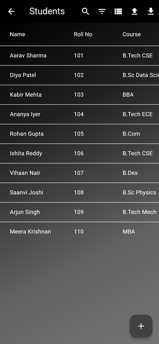</a><br><sub>Table view</sub></td>
    <td align="center"><a href="docs/screenshots/mobile-card-view.png">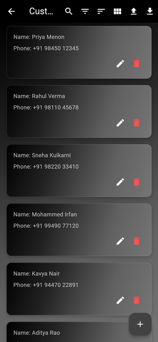</a><br><sub>Card view</sub></td>
    <td align="center"><a href="docs/screenshots/mobile-record-details.png">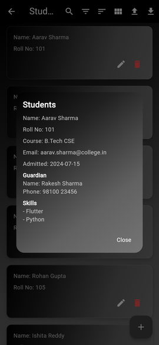</a><br><sub>Record details</sub></td>
  </tr>
  <tr>
    <td align="center"><a href="docs/screenshots/mobile-search-sort.png"></a><br><sub>Search &amp; sort</sub></td>
    <td align="center"><a href="docs/screenshots/mobile-filter.png">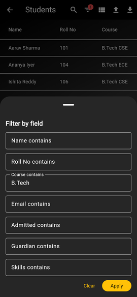</a><br><sub>Filter</sub></td>
    <td align="center"><a href="docs/screenshots/mobile-multi-select.png">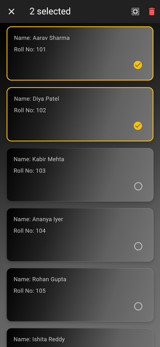</a><br><sub>Multi-select</sub></td>
    <td align="center"><a href="docs/screenshots/mobile-undo-delete.png">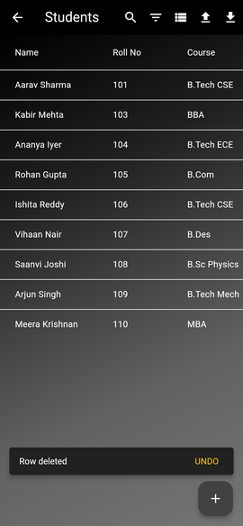</a><br><sub>Undo delete</sub></td>
    <td align="center"><a href="docs/screenshots/mobile-field-rules.png">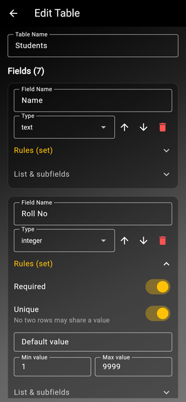</a><br><sub>Field rules</sub></td>
  </tr>
  <tr>
    <td align="center"><a href="docs/screenshots/mobile-create-table.png">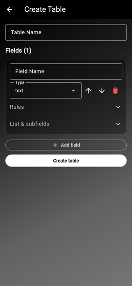</a><br><sub>Create table</sub></td>
    <td align="center"><a href="docs/screenshots/mobile-edit-table.png">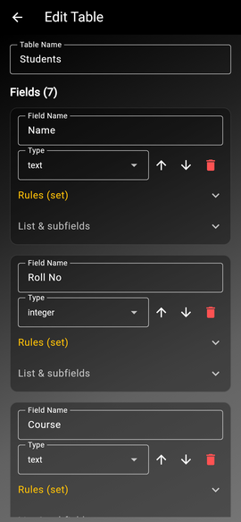</a><br><sub>Edit table</sub></td>
    <td align="center"><a href="docs/screenshots/mobile-add-row.png">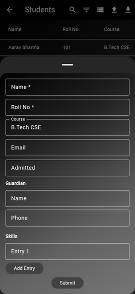</a><br><sub>Add row</sub></td>
    <td align="center"><a href="docs/screenshots/mobile-edit-row.png">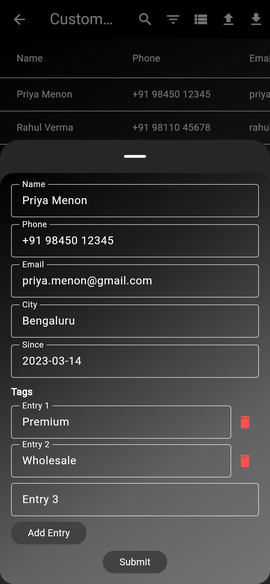</a><br><sub>Edit row</sub></td>
    <td align="center"><a href="docs/screenshots/mobile-inventory.png">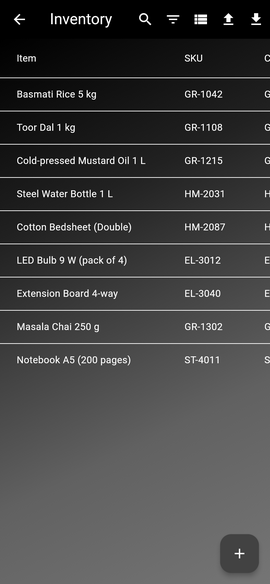</a><br><sub>Another table</sub></td>
  </tr>
</table>

**Tablet and desktop**

<table>
  <tr>
    <td align="center"><a href="docs/screenshots/tablet-table-view.png">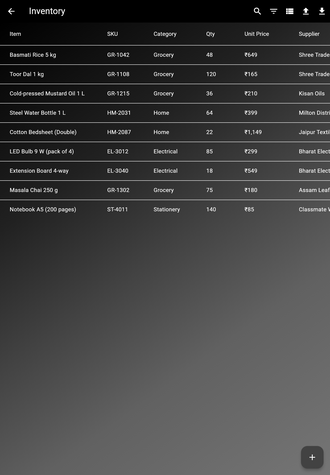</a><br><sub>Tablet: table view</sub></td>
    <td align="center"><a href="docs/screenshots/tablet-card-view.png">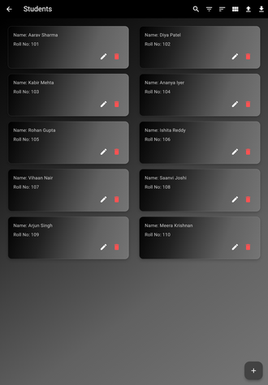</a><br><sub>Tablet: card grid</sub></td>
    <td align="center"><a href="docs/screenshots/desktop-table-view.png">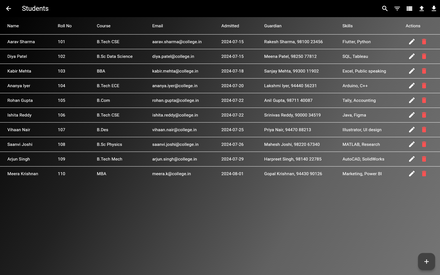</a><br><sub>Desktop: table view</sub></td>
  </tr>
  <tr>
    <td align="center"><a href="docs/screenshots/desktop-search-sort.png">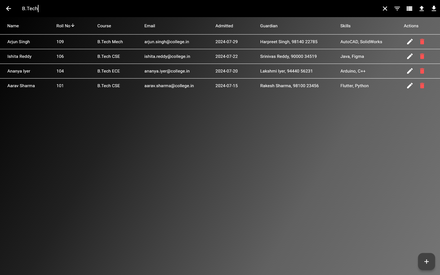</a><br><sub>Desktop: search &amp; sort</sub></td>
    <td align="center"><a href="docs/screenshots/desktop-card-view.png">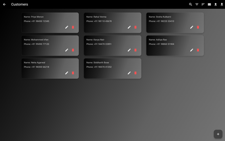</a><br><sub>Desktop: card grid</sub></td>
    <td align="center"><a href="docs/screenshots/desktop-edit-table.png">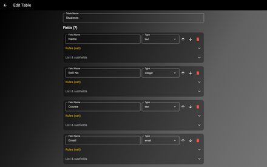</a><br><sub>Desktop: edit table</sub></td>
  </tr>
</table>

### Promo images

<p align="center">
  <a href="docs/thumbnails/datadazzle-thumb-2-devices.png">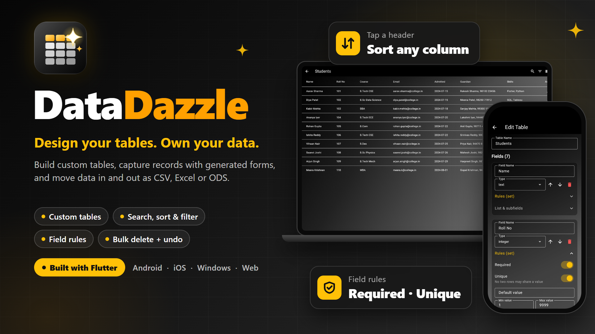</a>
  <a href="docs/thumbnails/datadazzle-thumb-3-gallery.png">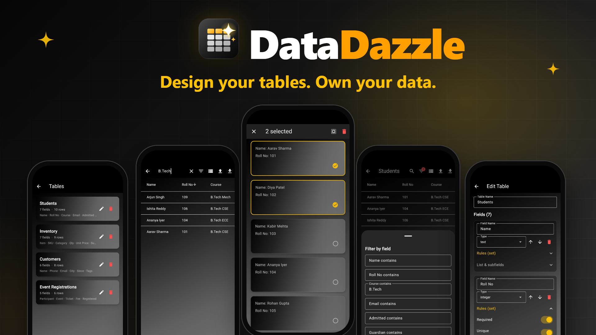</a>
</p>

## Tech stack

- Flutter and Dart (SDK 3.8 or newer)
- `sqflite` for the local database
- `csv`, `excel`, `archive` and `xml` for import (CSV, XLSX and ODS), `csv` and `excel` for export
- `file_picker`, `image_picker`, `path_provider` and `open_file` for files

## Project structure

```
lib/
  models/     table_definition (fields + rules), dynamic_item
  services/   database_helper (SQLite + migrations), data_store (storage interface),
              import_service (CSV/XLSX/ODS parsing and validation), file_handler (pick/export),
              item_query (search, sort, filter), field_validator (field rules)
  screens/    home, table manager, table form, table data
  widgets/    dynamic_item_card, dynamic_item_form, dynamic_item_table
  demo/       in-memory demo data store and routes, used for screenshots and the web preview
assets/brand/ logo (SVG and 512x512 PNG), full-bleed icon master, horizontal wordmark
docs/         screenshots/ (+ thumbs/) and thumbnails/ (promo images)
tool/         make_logo.py, capture_screenshots.py, make_thumbnails.py
test/         import, field rules, search/sort/filter, bulk delete, widget tests
```

## Getting started

```bash
flutter pub get
flutter run
```

Run the tests:

```bash
flutter test
```

### Demo build

A demo build swaps SQLite for seeded in-memory data, so it also runs on the web:

```bash
flutter run -d chrome --dart-define=DEMO=true
```

The screen can be chosen with `?route=<route>&table=<n>`. Routes: `home`, `tables`, `data`, `cards`, `add`, `edit-row`, `detail`, `create`, `edit`, `search`, `filter`, `select`, `undo`, `rules`.

## Regenerating the images

The logo, screenshots and promo images are all generated by scripts (Python with Playwright and Pillow):

```bash
python tool/make_logo.py                     # logo + launcher icons (Android, iOS, web, Windows)
flutter build web --release --dart-define=DEMO=true
python tool/capture_screenshots.py           # docs/screenshots + docs/screenshots/thumbs
python tool/make_thumbnails.py               # docs/thumbnails (1920x1080 promo images)
```

## Known gaps

- The `audio`, `video`, `excel` and `pdf` field types can pick and store a file but have little display support; only `image` is fully handled.
- Rows are stored as JSON and filtered in memory, which will slow down with many thousands of rows.
- Unique, min / max and pattern rules apply to single-value text, integer and email fields. Turning on *Unique* does not check rows that already exist.
- There is no light theme or settings screen yet; the app is dark only.
